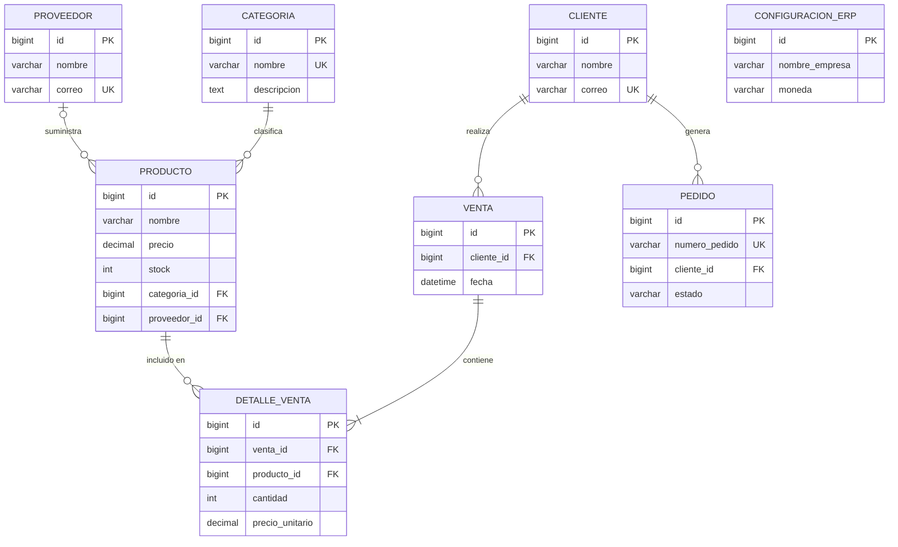

# Diagrama Entidad-Relación — ERP Django
## Espiral 2

## Cardinalidades

| Relación | Tipo |
|---|---|
| Categoria → Producto | 1:N obligatorio |
| Proveedor → Producto | 1:N opcional |
| Cliente → Venta | 1:N |
| Cliente → Pedido | 1:N |
| Venta → DetalleVenta | 1:N obligatorio |
| Producto → DetalleVenta | 1:N |